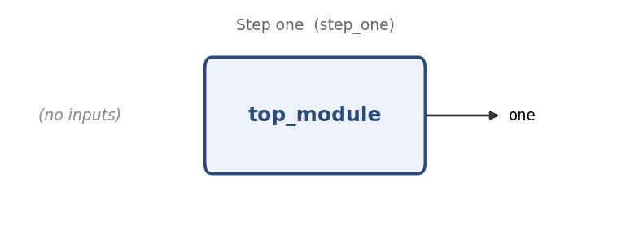

# Step one

**Problem ID:** `step_one`  
**HDLBits:** [https://hdlbits.01xz.net/wiki/Step_one](https://hdlbits.01xz.net/wiki/Step_one)

## Description

Build a circuit with no inputs and a single output `one` that is always driven to logic 1.

## Problem diagram



## Module interface

```verilog
module top_module(
    output one
);
```

## Approach

A constant driver. `assign` with a literal.

## Solution

[`solution.v`](solution.v)

```verilog
module top_module(output one);

    assign one = 1'b1;

endmodule
```
