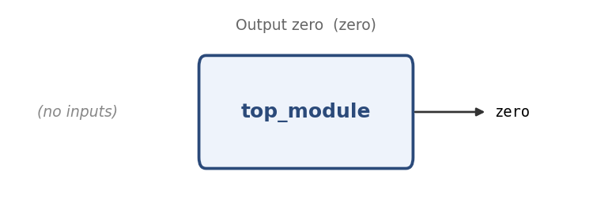

# Output zero

**Problem ID:** `zero`  
**HDLBits:** [https://hdlbits.01xz.net/wiki/Zero](https://hdlbits.01xz.net/wiki/Zero)

## Description

Build a circuit with no inputs and a single output `zero` that is always driven to logic 0.

## Problem diagram



## Module interface

```verilog
module top_module(
    output zero
);
```

## Approach

Same idea as step_one, with a constant 0.

## Solution

[`solution.v`](solution.v)

```verilog
module top_module(output zero);

    assign zero = 1'b0;

endmodule
```
