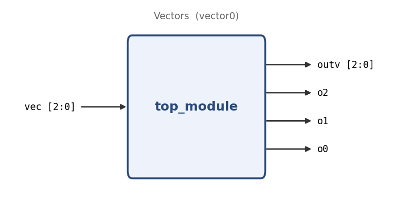

# Vectors

**Problem ID:** `vector0`  
**HDLBits:** [https://hdlbits.01xz.net/wiki/Vector0](https://hdlbits.01xz.net/wiki/Vector0)

## Description

Take a 3-bit input vector `vec`. Output it unchanged as the 3-bit vector `outv`, and also split it into three separate 1-bit outputs: `o0 = vec[0]`, `o1 = vec[1]`, `o2 = vec[2]`.

## Problem diagram



## Module interface

```verilog
module top_module(
    input  [2:0] vec,
    output [2:0] outv,
    output o2,
    output o1,
    output o0
);
```

## Approach

Whole-vector assign for `outv`; bit-select for each single-bit output.

## Solution

[`solution.v`](solution.v)

```verilog
module top_module(
    input  wire [2:0] vec,
    output wire [2:0] outv,
    output wire       o2,
    output wire       o1,
    output wire       o0
);

    assign outv = vec;
    assign o0   = vec[0];
    assign o1   = vec[1];
    assign o2   = vec[2];

endmodule
```
