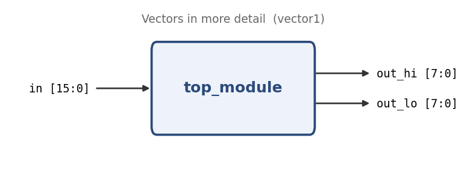

# Vectors in more detail

**Problem ID:** `vector1`  
**HDLBits:** [https://hdlbits.01xz.net/wiki/Vector1](https://hdlbits.01xz.net/wiki/Vector1)

## Description

Split a 16-bit input into its upper byte `out_hi` (bits [15:8]) and lower byte `out_lo` (bits [7:0]).

## Problem diagram



## Module interface

```verilog
module top_module(
    input  [15:0] in,
    output [7:0] out_hi,
    output [7:0] out_lo
);
```

## Approach

Part-select. `default_nettype none` is the point of this problem: undeclared names are no longer silently created as 1-bit wires.

## Solution

[`solution.v`](solution.v)

```verilog
`default_nettype none   // disable implicit nets; typos become errors
module top_module(
    input  wire [15:0] in,
    output wire [7:0]  out_hi,
    output wire [7:0]  out_lo
);

    assign out_hi = in[15:8];
    assign out_lo = in[7:0];

endmodule
```
