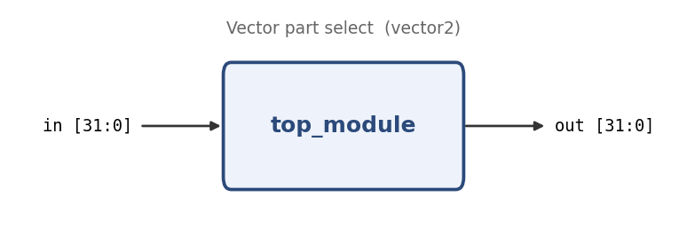

# Vector part select

**Problem ID:** `vector2`  
**HDLBits:** [https://hdlbits.01xz.net/wiki/Vector2](https://hdlbits.01xz.net/wiki/Vector2)

## Description

A 32-bit word holds 4 bytes. Reverse the byte order (little-endian <-> big-endian swap): `out[31:24] = in[7:0]`, `out[23:16] = in[15:8]`, `out[15:8] = in[23:16]`, `out[7:0] = in[31:24]`.

## Problem diagram



## Module interface

```verilog
module top_module(
    input  [31:0] in,
    output [31:0] out
);
```

## Approach

Concatenate the four byte part-selects in reverse order.

## Solution

[`solution.v`](solution.v)

```verilog
module top_module(
    input  [31:0] in,
    output [31:0] out
);

    assign out = {in[7:0], in[15:8], in[23:16], in[31:24]};

endmodule
```
