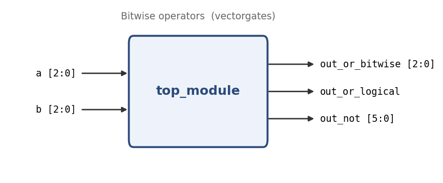

# Bitwise operators

**Problem ID:** `vectorgates`  
**HDLBits:** [https://hdlbits.01xz.net/wiki/Vectorgates](https://hdlbits.01xz.net/wiki/Vectorgates)

## Description

Given two 3-bit vectors `a` and `b`, compute: the bitwise OR (3 bits), the logical OR (1 bit), and the inverse of both packed into a 6-bit vector `out_not` with `~b` in the upper half and `~a` in the lower half.

## Problem diagram



## Module interface

```verilog
module top_module(
    input  [2:0] a,
    input  [2:0] b,
    output [2:0] out_or_bitwise,
    output out_or_logical,
    output [5:0] out_not
);
```

## Approach

`|` works per bit, `||` reduces each operand to a boolean first. Concatenation builds the 6-bit result.

## Solution

[`solution.v`](solution.v)

```verilog
module top_module(
    input  [2:0] a,
    input  [2:0] b,
    output [2:0] out_or_bitwise,
    output       out_or_logical,
    output [5:0] out_not
);

    assign out_or_bitwise = a | b;     // bit-by-bit OR
    assign out_or_logical = a || b;    // treats each vector as one true/false value
    assign out_not        = {~b, ~a};  // ~b -> [5:3], ~a -> [2:0]

endmodule
```
