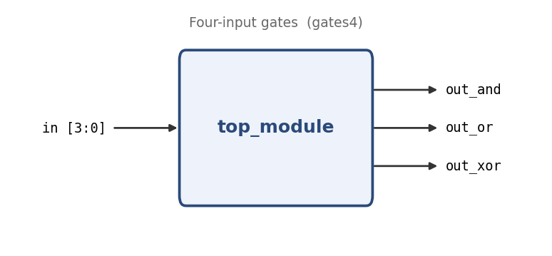

# Four-input gates

**Problem ID:** `gates4`  
**HDLBits:** [https://hdlbits.01xz.net/wiki/Gates4](https://hdlbits.01xz.net/wiki/Gates4)

## Description

Given a 4-bit input, produce three outputs: the AND of all four bits, the OR of all four bits, and the XOR of all four bits.

## Problem diagram



## Module interface

```verilog
module top_module(
    input  [3:0] in,
    output out_and,
    output out_or,
    output out_xor
);
```

## Approach

Reduction operators (`&`, `|`, `^` used as unary) collapse a vector into one bit.

## Solution

[`solution.v`](solution.v)

```verilog
module top_module(
    input  [3:0] in,
    output       out_and,
    output       out_or,
    output       out_xor
);

    assign out_and = &in;
    assign out_or  = |in;
    assign out_xor = ^in;

endmodule
```
