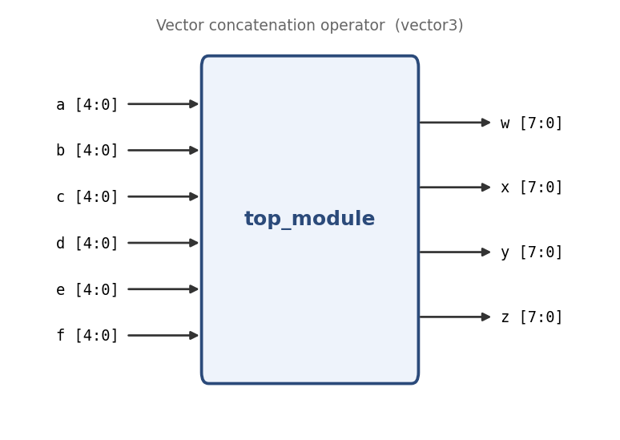

# Vector concatenation operator

**Problem ID:** `vector3`  
**HDLBits:** [https://hdlbits.01xz.net/wiki/Vector3](https://hdlbits.01xz.net/wiki/Vector3)

## Description

Six 5-bit inputs `a..f` are concatenated and followed by two 1-bits, giving 32 bits in total. Split these 32 bits into four 8-bit outputs `w`, `x`, `y`, `z` (w takes the most significant byte).

## Problem diagram



## Module interface

```verilog
module top_module(
    input  [4:0] a,
    input  [4:0] b,
    input  [4:0] c,
    input  [4:0] d,
    input  [4:0] e,
    input  [4:0] f,
    output [7:0] w,
    output [7:0] x,
    output [7:0] y,
    output [7:0] z
);
```

## Approach

Concatenation is legal on the left-hand side of an assign too.

## Solution

[`solution.v`](solution.v)

```verilog
module top_module(
    input  [4:0] a, b, c, d, e, f,
    output [7:0] w, x, y, z
);

    // 6*5 + 2 = 32 bits in, 4*8 = 32 bits out
    assign {w, x, y, z} = {a, b, c, d, e, f, 2'b11};

endmodule
```
