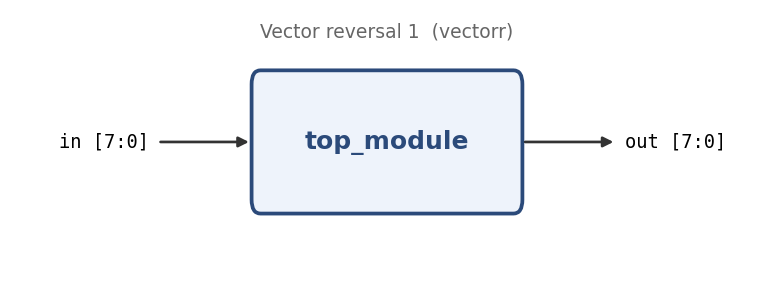

# Vector reversal 1

**Problem ID:** `vectorr`  
**HDLBits:** [https://hdlbits.01xz.net/wiki/Vectorr](https://hdlbits.01xz.net/wiki/Vectorr)

## Description

Reverse the bit order of an 8-bit input: `out[7]` gets `in[0]`, `out[6]` gets `in[1]`, ... `out[0]` gets `in[7]`.

## Problem diagram



## Module interface

```verilog
module top_module(
    input  [7:0] in,
    output [7:0] out
);
```

## Approach

Explicit concatenation for 8 bits; a for-loop version is left as a comment for wider vectors.

## Solution

[`solution.v`](solution.v)

```verilog
module top_module(
    input  [7:0] in,
    output [7:0] out
);

    assign out = {in[0], in[1], in[2], in[3], in[4], in[5], in[6], in[7]};

    // Alternative (scales to any width):
    // integer i;
    // always @(*)
    //     for (i = 0; i < 8; i = i + 1)
    //         out[i] = in[7-i];   // out must be declared `output reg [7:0]`

endmodule
```
