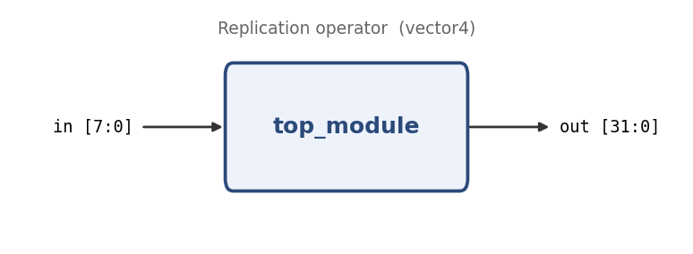

# Replication operator

**Problem ID:** `vector4`  
**HDLBits:** [https://hdlbits.01xz.net/wiki/Vector4](https://hdlbits.01xz.net/wiki/Vector4)

## Description

Sign-extend an 8-bit number to 32 bits by copying the sign bit `in[7]` into the 24 new upper bits.

## Problem diagram



## Module interface

```verilog
module top_module(
    input  [7:0] in,
    output [31:0] out
);
```

## Approach

`{24{in[7]}}` replicates the sign bit 24 times; the original byte goes on the right.

## Solution

[`solution.v`](solution.v)

```verilog
module top_module(
    input  [7:0]  in,
    output [31:0] out
);

    assign out = {{24{in[7]}}, in};

endmodule
```
