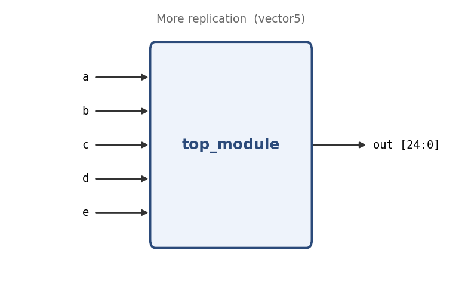

# More replication

**Problem ID:** `vector5`  
**HDLBits:** [https://hdlbits.01xz.net/wiki/Vector5](https://hdlbits.01xz.net/wiki/Vector5)

## Description

Given five 1-bit signals `a, b, c, d, e`, compare every pair (including each signal with itself) and output a 25-bit vector where each bit is 1 if the pair is equal. Bit 24 is `a` vs `a`, bit 23 is `a` vs `b`, ... bit 0 is `e` vs `e`.

## Problem diagram



## Module interface

```verilog
module top_module(
    input  a,
    input  b,
    input  c,
    input  d,
    input  e,
    output [24:0] out
);
```

## Approach

`left` repeats each signal 5 times in a row, `right` repeats the whole group 5 times; XNOR of the two yields all 25 pairwise equality bits.

## Solution

[`solution.v`](solution.v)

```verilog
module top_module(
    input        a, b, c, d, e,
    output [24:0] out
);

    // Each line: 5 copies of one signal vs. the pattern a,b,c,d,e.  XNOR = ~(x ^ y)
    wire [24:0] left  = {{5{a}}, {5{b}}, {5{c}}, {5{d}}, {5{e}}};
    wire [24:0] right = {5{a, b, c, d, e}};

    assign out = ~(left ^ right);

endmodule
```
